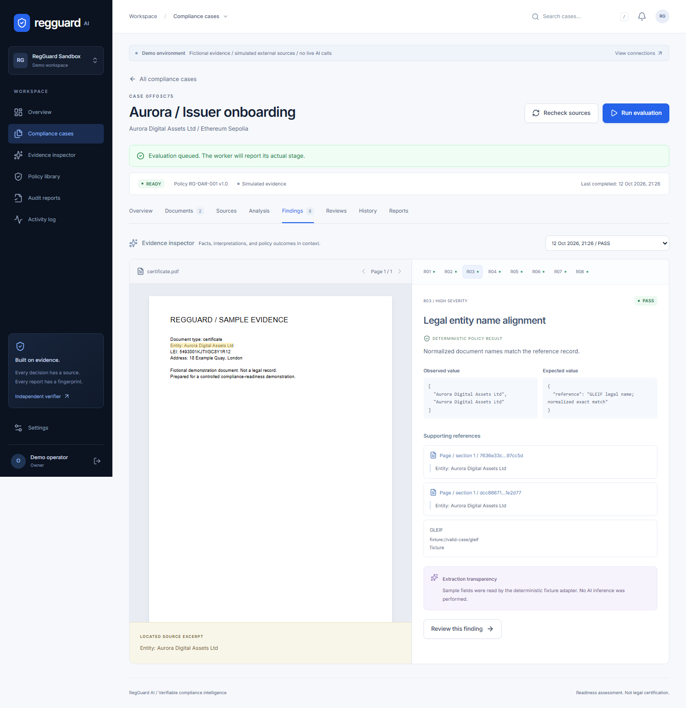

# RegGuard AI

**Verifiable compliance intelligence for digital asset issuer onboarding.**

RegGuard connects private evidence, cited extraction, versioned internal policies, human review, and independently verifiable report commitments. A PASS is a result against an internal policy, not a legal opinion or regulatory certification.



## Status - 12 October 2026

A working local vertical slice is implemented. The UI, API, durable worker, document processing, rule engine, replay, source changes, reviews, report exports, browser/CLI integrity verification and local EVM transactions have been exercised. **This is not yet a deployed production service.**

- 33 backend tests and 2 local setup tests; 16 Solidity tests including 256 fuzz cases; 5 JavaScript integrity tests.
- 4 browser tests: workflow, mobile creation, document upload, and accessibility/keyboard regression.
- PostgreSQL schema and RLS/immutability SQL executed with PGlite and emulated Supabase interfaces.
- Actual read-only GLEIF and Sepolia RPC responses recorded in [LIVE_READ_RESULTS.json](docs/LIVE_READ_RESULTS.json).
- CRE SDK 1.23.0 workflow compiled to WASM. CLI simulation requires missing CRE authentication.
- Supabase account flows, live paid OpenAI extraction, public Sepolia anchoring and Railway backend deployment remain unverified. See [BLOCKERS.md](BLOCKERS.md) and [TEST_REPORT.md](docs/TEST_REPORT.md).

## Hosted frontend and account setup

Website: **https://regguard-ai.vercel.app**. Independent verifier: **https://regguard-ai.vercel.app/verify**. The frontend is deployed; login and case processing await Supabase and Railway.

Follow [ACCOUNT_SETUP](docs/ACCOUNT_SETUP.md) for Supabase SQL/auth, Railway API + worker, Vercel variables, OpenAI key entry, Sepolia and CRE. A write-only local OpenAI form is available at http://127.0.0.1:8765/ while `scripts/start-local-setup.ps1` is running. Hosted keys belong in Railway Variables.

## Run the local demo (Windows)

Requirements: Node 24, Python 3.12, Git. No service account or paid key is needed for the fictional demo. Commands are run from the repository root.

```powershell
python -m venv .venv
.\.venv\Scripts\python.exe -m pip install -c services/api/requirements.lock -e 'services/api[dev]'
npm.cmd exec --yes --package=pnpm@12.11.2 -- pnpm install --frozen-lockfile
npm.cmd exec --yes --package=pnpm@12.11.2 -- pnpm build
powershell -NoProfile -ExecutionPolicy Bypass -File scripts/start-demo.ps1
```

Open **http://localhost:3000/login** and choose **Launch demo workspace**. Each launch creates an isolated organization and three fictional cases. Open **Aurora / Issuer onboarding**, run its evaluation, then inspect R03. API documentation: http://localhost:8000/docs.

The helper starts API, worker and web processes with hidden windows, stores their identifiers, and writes logs under `.data`. The execution-policy flag applies only to this PowerShell process, not the machine policy.

```powershell
powershell -NoProfile -ExecutionPolicy Bypass -File scripts/stop-demo.ps1
```

If ports 3000/8000 are occupied, stop the conflicting service before starting. Stopping does not erase evidence. Demo sessions expire after eight hours; local records persist in `.data`. Keep that directory private.

## macOS / Linux

Install the same dependencies using `.venv/bin/python` and `pnpm` 12.11.2, then run `pnpm build`. In each backend terminal set `APP_ENV=development`, `DEMO_MODE=true`, `DATABASE_URL=sqlite:///./.data/regguard.db` and `APP_ORIGIN=http://localhost:3000`.

```bash
.venv/bin/python -m alembic -c services/api/alembic.ini upgrade head
# Terminal 1
.venv/bin/python -m uvicorn app.main:app --host 127.0.0.1 --port 8000
# Terminal 2, same environment
.venv/bin/python -m app.worker
# Terminal 3
pnpm --filter @regguard/web start --hostname 127.0.0.1
```

For frontend development use `pnpm dev` instead of the production server. Filesystem sample uploads are in `fixtures/documents`.

## Problem and intended users

Issuer onboarding teams need to reconcile private declarations, legal-entity reference data and blockchain identifiers while preserving the reason for each decision. RegGuard brings those inputs into one case, links findings to evidence and preserves a verifiable report for a reviewer or counterparty. Intended users are compliance analysts, legal operations teams and digital asset issuer onboarding teams; no customer adoption or market-size claims are made.

## Roadmap

The next milestone is account-backed Supabase testing, a measured live extraction run, CRE simulation and authorized Sepolia deployment. After that: retention/deletion controls, team administration, signer isolation, operational monitoring and a security review before any production evidence is admitted. See [FINAL_STATUS](docs/FINAL_STATUS.md) for the full acceptance checklist.

## Repository

```text
apps/web/                       Next.js App Router UI, PDF viewer, browser verifier, Playwright
services/api/app/               FastAPI, auth, connectors, rules, reports, worker
services/api/migrations/        Frozen Alembic schema migration
services/api/tests/             Authorization, workflow, upload, uncertainty and job tests
services/worker/                Worker operations notes (implementation: app.worker)
packages/shared-schemas/        Shared browser/CLI canonical commitments and verification
policies/                      RG-DAR-001 v1.0 / v2.0, restricted rule schema
contracts/                     Solidity AuditRegistry, CRE receiver, Foundry tests/deployment
cre/                           CRE project and TypeScript workflow
infra/database/                PostgreSQL DDL and Supabase RLS/storage hardening
fixtures/documents/             Clearly fictional PDF samples
scripts/                       Demo lifecycle, integrity, chain and database tests
.github/workflows/              CI checks
docs/                          Architecture, security, deployment, pitch/demo/submission
```

## Verify the implementation

Use `npm.cmd exec --yes --package=pnpm@12.11.2 -- pnpm ...` wherever `pnpm` is not installed.

```powershell
.\.venv\Scripts\python.exe -m pytest services/api/tests scripts/tests -q
.\.venv\Scripts\ruff.exe check services/api
pnpm typecheck
pnpm lint
pnpm build
node --test scripts/integrity.test.mjs
node scripts/test-database.mjs
# Start the demo first; install the browser once:
pnpm --filter @regguard/web exec playwright install chromium
pnpm test:e2e
forge test --root contracts -vv
```

Python's happy-path test produces `.data/sample-report.json`; run it before the JavaScript cross-language tests. `forge` and `anvil` are Foundry tools. This workspace also has untracked Windows binaries under `.tools`; no installed binary is committed.

```powershell
# Separate terminal: local chain only; public development accounts have no real funds.
anvil --host 127.0.0.1 --port 8545 --chain-id 11155111
node scripts/test-local-chain.mjs
# Verify an exported package without accessing RegGuard's API or database:
node scripts/verify-report.mjs .data/sample-report.json
node scripts/verify-report.mjs private-report.json --rpc https://YOUR_SEPOLIA_RPC --registry 0xYOUR_TRUSTED_REGISTRY
```

A local hash match reports `ANCHOR_NOT_FOUND`; it does not prove authenticity. `VERIFIED` requires matching finalized contract state and the actual transaction event in an independently trusted registry. Anvil uses Sepolia's chain ID only to test the integration; it is not Sepolia.

## Live configuration and submission preparation

Start with `.env.example`; server secrets go in root `.env`, browser-safe `NEXT_PUBLIC_*` values in `apps/web/.env.local`. Never expose a service-role key, OpenAI key or signer through `NEXT_PUBLIC_*`.

Read [DEPLOYMENT](docs/DEPLOYMENT.md), [ARCHITECTURE](docs/ARCHITECTURE.md), [SECURITY](docs/SECURITY.md), [POLICY](docs/POLICY.md), [API](docs/API.md), and [CRE README](cre/README.md). The [demo script](docs/DEMO_SCRIPT.md), [pitch content](docs/PITCH_DECK_CONTENT.md), and [submission draft](docs/DORAHACKS_SUBMISSION.md) distinguish verified and unavailable integrations. Nothing has been submitted or published.
