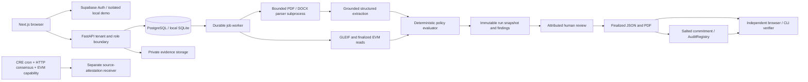

# Architecture

RegGuard evaluates **internal issuer onboarding readiness**, preserving the information used in each decision. It does not implement a jurisdiction's complete securities law or certify an issuer.

## Boundaries and data

Every private row carries an organization ID. JWT signature, issuer, audience and expiry are checked against Supabase JWKS. The API resolves a membership and authorizes operations before retrieving rows. PostgreSQL service credentials are a trusted backend boundary; browser RLS is defense in depth. Browser access to salts and signed transactions is denied at the SQL privilege layer.

Documents enter private storage under generated organization/case/document paths. A digest binds the original bytes. Parser subprocesses have deadlines, document/page/text/archive limits, and reject unsupported/scanned content. They do not run document macros or request external relationships. A production container still needs OS-level memory/CPU limits and malware controls.

The worker stores jobs before returning 202. PostgreSQL uses row locking and SKIP LOCKED; SQLite uses conditional updates for local demo fencing. Leases, heartbeat, persisted attempts, backoff and terminal failure recovery prevent abandoned cases remaining busy. Evaluation commits one immutable snapshot and findings. Three execution attempts are allowed. Pending blockchain finality is polled separately without consuming that retry budget.

Live extraction uses OpenAI Responses structured output. Citations are checked against exact document ID, page/section, excerpt and literal value. No model tools, dynamic code execution, or model-generated PASS decisions are used. Missing credentials or rejected citations preserve uncertainty. Demo extraction uses an explicitly labeled deterministic parser; it makes no LLM calls.

Policy documents and sources are included in a finalized report. Rule outcomes remain original after human review; decisions add attributed records. Replays reuse the original snapshot's evaluation timestamp and source bytes, while source rechecks collect a new snapshot and generate diffs. Replay is not a fresh source check.

## Commitments

RFC 8785 canonical JSON is shared between Python and JavaScript. The report commitment is SHA-256 over `REGGUARD:REPORT:v1` plus NUL, an eight-byte big-endian canonical byte length, the canonical UTF-8 payload, and a random 32-byte salt. Policy hashes use `REGGUARD:POLICY:v1` plus NUL and canonical policy bytes. A random 32-byte record key avoids writing case IDs, names, LEIs, excerpts or document links on-chain.

The private JSON package contains report, salt, commitment, record key and optional public anchor metadata. The PDF is a human-readable rendering, not the canonical hash artifact. Anyone holding a package can recompute a different package and hash: authenticity therefore requires independently trusted registry identity and a matching finalized event/state. Blockchain integrity does not validate the truth of source documents.

## Chainlink scope

The CRE workflow is a separate public-source attestation pipeline. It fetches GLEIF through the HTTP capability with identical consensus, calls AuditRegistry.contractExists at finalized EVM state, hashes a fixed ABI tuple, and optionally writes a signed report through the configured forwarder to IssuerEvidenceReceiver. It does not receive private uploaded documents or the report salt.

The receiver pins the forwarder, workflow ID and workflow owner, checks report freshness and rejects duplicate keys. The UI displays CRE as unavailable until authenticated execution evidence exists. Compiling a workflow, running Python connectors, or an Anvil transaction does not establish DON execution. A verified execution-artifact ingestion path is still incomplete.

## Deliberate limits

One active organization per session (first membership), one signer worker, Sepolia only, five documents per case, 10 MB each, 100 pages and 100,000 extracted characters. A minimal native EVM wallet connector uses Viem instead of adding a second Wagmi state layer. OCR, team invitations, scheduled rechecks, automatic retention and cross-chain anchoring are outside this build. See SECURITY and BLOCKERS before production use.
